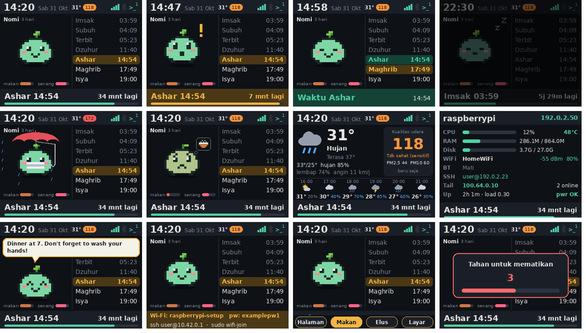

# Prayer Pet

Project docs: [PRD.md](PRD.md) (features, design, decisions) · [AGENTS.md](AGENTS.md) (how to develop) · [HANDSOFF.md](HANDSOFF.md) (current state).
Develop: `python3 -m unittest discover -s tests -t .` · Release: `bash scripts/package.sh`

Prayer times, a system status monitor and a small pet on the Adafruit PiTFT 2.8" (320x240).

## Install
    bash install.sh

## Everyday commands
| What you want | Command |
|---|---|
| Change settings | `nano ~/prayerpet.toml` then `sudo systemctl restart prayerpet` |
| See today's times | `prayerpet --times` |
| See times for a date | `prayerpet --times 2026-12-25` |
| See logs | `journalctl -u prayerpet -f` |
| Stop / start | `sudo systemctl stop prayerpet` / `sudo systemctl start prayerpet` |
| Turn off auto-start | `sudo systemctl disable prayerpet` |
| Check screen, touch and buttons | `prayerpet --info` |
| Check weather and air quality | `prayerpet --weather` |
| Calibrate touch | `sudo systemctl stop prayerpet` then `prayerpet --touch-test` |
| Save a screenshot | `prayerpet --png ~/shot.png` (add `--page status` or `--at "2026-10-31 14:50"`) |

## Using the screen
- Tap the pet: feeds it when hungry, otherwise pats it (hearts).
- Tap anywhere else (or the Page button): pet page -> weather page -> status page.
- It rains: the pet holds an umbrella. Air quality is unhealthy (US AQI over 150): the pet wears a mask.
- 10 minutes before each prayer the pet gets excited and the bottom bar turns gold.
- For 15 minutes after a prayer starts, the bottom bar turns green.
- From 1 hour after Isya until 20 minutes before Subuh, the pet sleeps and the screen dims. A tap brightens it for 30 seconds.

## Files
- `~/prayerpet.toml` - your settings
- `~/.prayerpet-state.json` - the pet's hunger, happiness and age (delete it to start a new pet)
- `~/prayerpet-app/` - the program
- `/etc/systemd/system/prayerpet.service` - starts it at boot

## Wi-Fi at a new place
If the Pi finds no known Wi-Fi about 90 seconds after boot, it starts its own hotspot (`<hostname>-setup`).
The screen shows the hotspot password and the SSH command.
1. Join the hotspot from your Mac.
2. `ssh <user>@10.42.0.1`
3. `wifi-join --list` to see nearby networks, then `sudo wifi-join "NETWORK" "PASSWORD"`.
The Pi leaves the hotspot and joins the new network. If that fails, the hotspot comes back within about a minute.
Settings: `/etc/wifi-fallback.conf`. Turn off with `sudo systemctl disable wifi-fallback`.

## Messages on the screen
- `prayerpet --say "Dinner at 7" --minutes 30` shows a speech bubble above the pet.
- `prayerpet --feed` / `prayerpet --pat` act on the pet from the command line.
The Telegram bot and the AI assistant use the same commands (through the folder ~/.prayerpet-inbox).

## Telegram bot
1. In Telegram, message @BotFather, send /newbot, copy the token.
2. `nano ~/.prayerpet-telegram.toml` and paste it into `token = "..."`.
3. Send your new bot any message, then run `prayerpet --bot-whoami` and put your user id into `allowed_ids = [...]`.
4. `sudo systemctl enable --now prayerpet-bot`
Commands: /times /next /weather /status /screen /pet /feed /pat /say /ask /help.
It only answers the user ids in allowed_ids, only in a one-to-one chat, and never runs shell commands.
If Telegram is blocked on the Pi's network, set a proxy: `sudo systemctl edit prayerpet-bot` and add
`[Service]` then `Environment=HTTPS_PROXY=http://PROXY:PORT`.
Logs: `journalctl -u prayerpet-bot -f`

## AI assistant (Antigravity CLI)
`~/.gemini/GEMINI.md` tells the assistant what runs on this Pi and which commands are safe.
